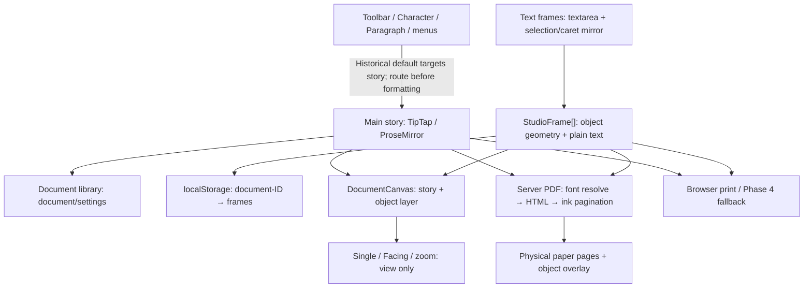

# Qalam Page — Engineering Handbook

**Status:** Standing engineering and review instructions.  
**Date established:** 2026-10-28.  
**Scope:** `app/tools/document-studio/`, `app/api/export-pdf/`, relevant text/font/PDF helpers, and tests.  
**Evidence baseline:** [Architecture audit, 2026-10-28](reviews/qalam-page-engineering-audit-2026-10-28.md), reviewing **Draft PR #144** at `2b3d7aa3eda83e7db5c470b5b67e9dbfbe6eef3f`.  
**Related policies:** [AI collaboration rules](AI-COLLABORATION.md), [general architecture](ARCHITECTURE.md), [document specification](DOCUMENT-STUDIO-SPEC.md).

> **IMPORTANT:** This handbook is an enduring procedure, **not** an approval to implement any proposed redesign. The audit is a dated snapshot; verify current code, the latest approved decisions, branch/PR state, and behavior before using it. The latest evidence wins over stale documentation. Never merge or deploy to production without explicit owner approval.

## مالک کے لیے مختصر خلاصہ

قلم پیج کو نئے سرے سے بنانے کی ضرورت ثابت نہیں ہوئی۔ مرکزی عبارت کا نظام اور ٹیکسٹ باکس کا نظام اس وقت الگ ہیں۔ فونٹ کے بٹن غلط عبارت کو بدل سکتے ہیں، اور پی ڈی ایف میں فونٹ یا صفحے کی ترتیب بدلنے کا خطرہ ہے۔ ہر نئے پروگرامر کو پہلے یہ دستاویز، اصل جائزہ اور موجودہ کوڈ پڑھنا ہوگا؛ صارف کی عبارت محفوظ رکھنا پہلی ترجیح ہے۔

## 1. Mandatory agent preflight

Before editing Qalam Page:

1. Read this handbook, `docs/AI-COLLABORATION.md`, and the dated architecture audit. Also read other relevant product decisions.
2. Inspect **actual current** branch, head SHA, PR draft/merge state, the files to be edited, their callers, and tests. Do not assume PR #144 has merged or that 2026-10-28 paths/bugs are unchanged.
3. Explain scope, risks, affected subsystems, non-goals, and an acceptance test. Do not expand scope or execute a major redesign without owner approval.
4. Label every important statement **Verified**, **Inferred**, **Proposed**, or **Unresolved**. A failed reproduction is not evidence that the bug never occurs.
5. Prefer the smallest safe change. Reuse stable primitives; do not rewrite the whole editor to fix one feature.
6. Write a failing behavioral test first for a bug fix when practicable. Compare before/after against the same document snapshot.
7. No unauthorized merge, production deploy, environment change, billing, license change, or font-binary edit. Respect draft/preview instructions on each task.
8. Never print credentials or persist sensitive user content in fixtures or logs. Use synthetic fixtures.

## 2. Current architectural map — dated snapshot

- **Main story:** `DocumentStudioEditor.tsx`, `documentSchema.ts`, ProseMirror model/marks/history, formatting handlers and `DocumentCanvas.tsx`.
- **Frame editing:** `StudioObjectLayer.tsx` owns object selection, placement, resize and drawing; `StudioTextFrame.tsx` uses a native textarea and a mirror for painted caret/selection.
- **Storage boundary:** the document library stores story/settings; drawing frames use a separate `localStorage` map. Their writes are **not atomic**. A saved library record is not necessarily the live editor snapshot.
- **Geometry:** `QalamPagination.ts` measures canonical story flow; `facingPages.ts` and zoom transform the display, **not** print coordinates.
- **Server PDF:** `app/api/export-pdf/route.ts`, `buildPdfHtml.ts`, `pdfInkPagination.ts`, font guard/loader and `printableFrames.ts`.
- **Browser print:** `documentView.ts` clones/prints the story and overlays validated frames; Phase 4 recovery uses the browser route.
- **Font behavior:** discovery, file availability, browser readiness, actual use and embedded family are distinct checks. An available fallback is **not** proof that the requested face was used.

**Version warning:** These descriptions are verified by the linked October audit of PR #144; their current status must be rechecked.

## 3. Non-negotiable engineering contracts

### 3.1 Preserve the user's work

- Formatting a frame must leave **main story JSON byte-for-byte unchanged**, except changes explicitly requested to the story. The converse applies to story formatting.
- Never apply a command to a stale or unrelated selection. When the intended target is unsupported/invalid/ambiguous, **fail closed** with a clear user-facing message.
- Changing fonts, selection, object geometry, export layout or page mode must not silently alter Unicode text, mark ranges or saved frame content.
- Existing documents and legacy `StudioFrame` plain-text data must load without rewriting or losing text. Do not silently migrate on read.
- User content, selected fonts and object positions must survive edit → save → reload → export, subject only to clearly disclosed and tested limitations.

### 3.2 Editing-target ownership

Every formatting action must resolve **exactly one** valid context:

- `story`: current document ID + valid ProseMirror selection/bookmark.
- `frame`: current document ID + existing frame ID + valid box-editor selection/bookmark.
- `none`: no editing selection.

Treat **browser focus** (which control has keyboard focus) separately from **formatting target** (which validated selection gets the command). Toolbar/dialog focus must not move a frame command into the main story. Validate document ID, frame existence, revisions and editor lifetime before dispatch. Invalidate bookmarks on document switch, deletion or genuine dismissal. Do not treat object selection alone as permission to format a whole text range.

**Immediate containment rule:** until rich formatting is truly implemented in frames, reject unsupported selected-text formatting **inside a frame** instead of routing it to the story. Preserve legitimate main-story formatting. This is a safety measure, **not** an implementation of rich frame formatting.

### 3.3 Selection and caret visuals

- Selected content must remain visibly and accurately selected while formatting controls are in use; highlighting must represent a **real, valid** model range, not an out-of-date screenshot.
- Clear visible selection on genuine dismissal/target change, not merely because the toolbar received focus.
- An empty RTL frame must show the insertion caret on the right **before** typing. Verify against font-loading and scale/facing transforms.
- Arrow/Select tool and Text tool have distinct pointer behavior. Single-line and multiline boxes must be selectable without accidental document selection.

### 3.4 Text-box formatting architecture

The audit recommends **restricted TipTap/ProseMirror editing in boxes, behind a small shared command/selection-target interface**. This is a **proposal**, not authorization to redesign the editor.

Before approving this work, require a design covering:

- Versioned structured content and an adapter for legacy `text`; exactly one authoritative editable representation.
- Selection-aware marks; edit/paste/IME composition; RTL/BiDi shaping, diacritics, joins and wrapped ranges.
- Undo/redo, font changes, supported marks, overflow/clipping/scrolling, keyboard focus and performance with many boxes.
- Matching screen, server-PDF and browser-print serializers.
- Restricted schema initially: text, paragraphs, supported marks and hard breaks. No copied story pagination, page breaks, nested boxes or tables by default.
- Lazy editor activation where safe, and review of global `.ProseMirror` CSS/queries/listeners before adding box editors.

Do **not** emulate per-word rich text by styling an entire textarea or maintain two independently editable copies of the same frame text.

### 3.5 Page geometry and PDF fidelity

The agreed contract to **test** before refactors:

- Physical paper origin = upper-left of the sheet.
- Each frame's `xMm/yMm/wMm/hMm` = physical-page-local millimetres.
- Main story origin = resolved physical page margins.
- Single/Facing presentation and zoom must **not** affect stored object geometry or PDF positions.
- Finalize story pagination **before** adding object overlays; an overlay alone must not reflow story text.
- Preserve deliberate author-created overlap. Fix only unintended shifts; do not auto-move boxes to hide the defect.
- Export the five supported kinds (rect, ellipse, rounded rectangle, line, text), on the intended page.
- Validate payload bounds and escape text; do not accept arbitrary HTML/SVG/CSS as frame input.
- Browser and server PDF have separate rendering paths; passing one does **not** certify the other.

A regression test must compare the **same saved/snapshot content**, margins and font bytes, first with no frame and then with a non-overlapping frame. Story glyph coordinates, line endings and pagination should remain equivalent. Include later pages, unequal margins, headers/footers, Arabic/Urdu/English text, clipping and page boundaries.

### 3.6 Exact font evidence, not visual guesses

- Respect authored font selection and existing font license decisions. Do **not** replace font files or weaken Unicode/font guards to make tests pass.
- Log/report requested family, source availability, download/completeness, browser `document.fonts` outcome, fallback actually used, and **embedded font**. Never log URLs containing secret credentials.
- The audit confirms Jameel Noori embedded in the owner's live PDF, but Noto Nastaliq Urdu and Mehr in the preview PDF. The precise historical preview failure **remains unresolved**.
- An error or fallback must not be reported as a faithful export using the requested font. Never "repair" mismatched glyph metrics with arbitrary line-height adjustments.
- Digital Khatt is for its approved Arabic/Quranic use; do not touch the Muhammadi Quranic font. Follow current font-policy decisions for Urdu prose.

### 3.7 Storage, history and compatibility

- Recognize the current gap: story and frames are separate stores with no atomic save; main story history and textarea history are also separate.
- Any future unified snapshot/revision scheme must be versioned, backward compatible, and explicitly approved.
- Verify quota denial, interrupted writes, rapid document switching and recovery before claiming lossless persistence.
- Do not silently rewrite all old documents on open.

## 4. Owner-reported defects and audit certainty (2026-10-28)

| ID | Problem | Verified vs. unresolved | Safe next direction |
| --- | --- | --- | --- |
| **A** | New empty RTL-frame caret initially on left | Reproduced; empty mirror/bidi rectangle cause probable | Correct initial right-edge measurement; test fonts and zoom |
| **B** | Single-line frame not reliably selectable | Not conclusively reproduced | Trace pointer/focus/selection ID; preserve Arrow/Text distinction |
| **C** | Font changes inside frame fail | Confirmed data-model limitation | Rich frame marks and renderer after design approval |
| **D** | Highlight disappears when toolbar focused | Confirmed blur/selection-paint path | Validate target/bookmark and paint only live selection |
| **E** | Frame-font action modifies outside story | Reproduced: **data-integrity defect** | **P0 containment:** reject wrong-target commands, never stale-story fallback |
| **F** | Preview PDF has different font and leading | Embedded faces differ; historical failure mechanism not proven | Font manifest and identical-snapshot real-PDF comparison |
| **G** | Objects overlap story unexpectedly | Composition path found; exact cause not isolated | Compare canonical mm, screen positions and PDF pixels |

Read the [complete dated audit](reviews/qalam-page-engineering-audit-2026-10-28.md) for evidence, limitations and file references. Do not mark unresolved causes as fixed or verified.

## 5. Approved priority order is not automatic implementation approval

1. **P0 safety containment:** ensure box-target formatting never modifies story text.
2. **Interaction fixes:** initial RTL caret, reliable single-line frame selection, truthful selection highlight.
3. **PDF baseline:** exact-font outcome, stable story layout with/without frames, server/browser frame geometry.
4. **Rich boxes (design approval required):** restricted ProseMirror model + explicit command router + legacy adapter.
5. **Persistence architecture (design approval required):** coherent versioned document/frame snapshot.
6. **Hardening:** golden fixtures, selective editor activation, scoped CSS/handlers and performance safeguards.

Each phase requires a separate, bounded owner-approved scope and its own tests. Do not mix PDF/font refactors into an isolated selection-safety change.

## 6. Required evidence and acceptance gates

For each material editor/export change, provide:

1. **Behavioral reproduction:** initial failing test or exact documented sequence; desktop and mobile when relevant.
2. **Model tests:** editing target, serialized marks/text, document switch, undo/redo and legacy fixtures.
3. **Real editor tests:** selection, toolbar focus, keyboard, paste/IME where relevant, zoom and Facing mode.
4. **Real PDF inspection:** embedded font names and Unicode extraction, rendered pixels, physical coordinates, glyph baselines/line endings, page counts and margins. HTML-only checks are insufficient.
5. **Regression safety:** expected untouched story JSON for a box-only action, untouched object geometry for a story-only action, exact legacy load behavior.
6. **Build/check reporting:** TypeScript, focused Vitest, focused Playwright, broader relevant checks and known CI failures reported separately. Do not claim CI passes if any relevant job fails; do not hide pre-existing failures.
7. **Before/after comparison:** same snapshot and settings, no unexplained change to golden documents.
8. **Owner review:** precise files changed, evidence, remaining limitations, new SHA/PR status and **no merge/deploy** without explicit approval.

Test families should cover Jameel success/unavailability, Mehr, Digital Khatt Arabic, mixed Urdu/Arabic/English, harakat, manual breaks, line-height/Auto leading, unequal margins, five frame kinds, deliberate overlap, >1 page and both printing paths. Use raster tolerances suitable for antialiasing **in addition** to font/coordinate assertions.

## 7. Mandatory handoff format for agents

End every Qalam Page task with a short report:

- **Baseline:** repository, branch, before/after SHA, PR draft state.
- **Scope:** what was authorized and which files changed.
- **Evidence:** Verified / Inferred / Proposed / Unresolved, with test or source pointers.
- **Safety:** user content, wrong-target formatting, save/reload, font and PDF checks.
- **Tests:** exact counts, skips, failures and CI distinctions.
- **Remaining risks:** named, not concealed.
- **Release state:** preview only, draft, merged or deployed — report exactly what happened.
- **Next decision:** what owner approval would be needed; do not silently proceed.

**Primary rule:** preserving the author's exact text and print fidelity outranks cosmetic feature completion.