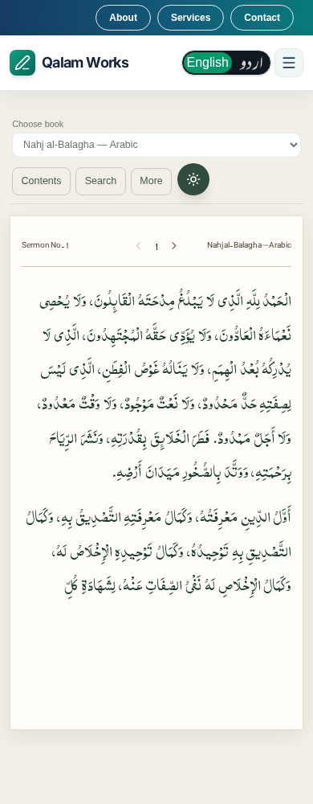
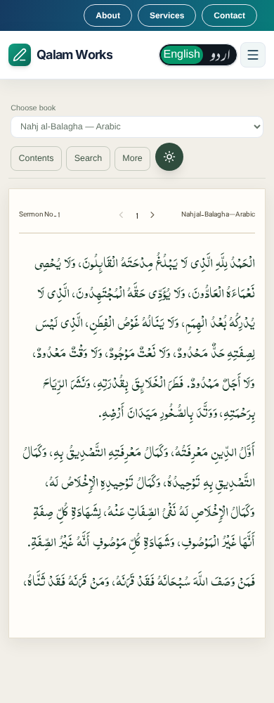
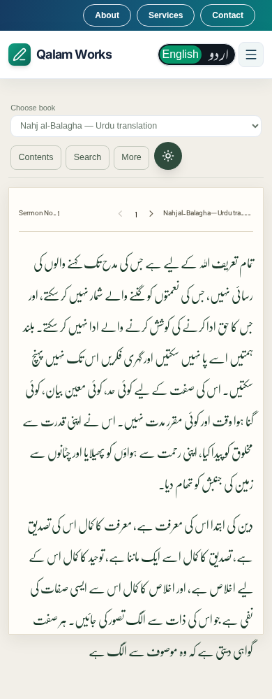
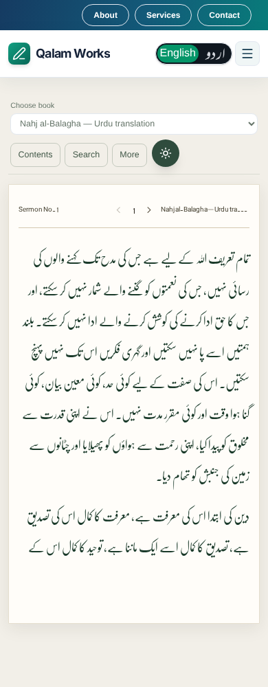

# Late-font reader pagination review

390px captures use the existing mocked Nahj al-Balagha Arabic and Urdu excerpts. No production source text or font files were changed.

The test delays font responses by two seconds, starts with a failed primary-face request (fallback pagination), then loads the original Noorehuda or Nafees Nastaleeq file successfully. This exercises a font arriving after the initial `document.fonts.ready` promise. It also resizes/orients on page 2, checks the source anchor, checks every page for overflow, and verifies continuous source offsets through the complete first section. First pages must retain at least ten lines.

| Script | Before | After |
| --- | --- | --- |
| Arabic (Noorehuda) |  |  |
| Urdu (Nastaliq) |  |  |

The unmodified reader reproduced 67px of mobile Urdu overflow and also overflowed at 1280px. The Arabic fixture did not reproduce the owner's exact overflow, but the same late-font transition is covered for Arabic at both widths. After reflow, extra text continues on the next page rather than being discarded or left outside the card.

Before captures use the unchanged pre-fix reader build (reader source identical to main `da22e538`). After captures use this branch. Reproduce the captures by setting `READER_CAPTURE_LABEL=after` when running `tests/e2e/khateebReaderFontLoading.spec.ts`.

Validation: TypeScript and production build passed. The production-build Playwright run passed all 14 cases (8 delayed-font cases across both browser projects, 2 Noorehuda/Quran font-separation cases, 4 public-library cases). Full Vitest: 4,378 passed, the same 42 known main failures, 100 skipped. No new failing test names compared with the main baseline.
