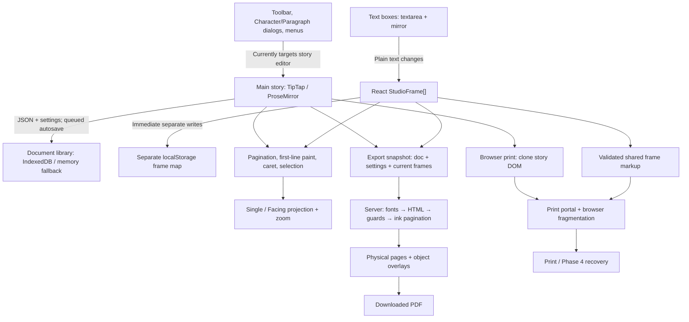

# Qalam Page — Engineering architecture audit (2026-10-28)

> **Evidence snapshot, not implementation permission.** This is the complete audit supplied by the owner, retained for future agents. It describes **Draft PR #144** at commit `2b3d7aa3eda83e7db5c470b5b67e9dbfbe6eef3f`; do **not** assume these changes exist on `main` or that the bugs are already fixed. Read the standing rules in [QALAM-PAGE-ENGINEERING.md](../QALAM-PAGE-ENGINEERING.md) before acting. The original author's `/tmp` test artifacts are temporary and are **not** reproduced in this repository. Local source links were rewritten to repository-relative links where possible.

---

**مالک کے لیے آسان خلاصہ**

قلم پیج کو ازسرِنو بنانے کی ضرورت نہیں۔ اصل مسئلہ یہ ہے کہ مرکزی تحریر اور ٹیکسٹ باکس دو مختلف طریقوں سے ایڈٹ ہوتے ہیں، مگر فونٹ اور فارمیٹنگ کے بٹن صرف مرکزی تحریر کو حکم دیتے ہیں۔ اسی لیے باکس کے اندر منتخب لفظ کا فونٹ بدلنے سے باہر کی تحریر بدل سکتی ہے۔ **سب سے پہلے اس خطرے کو روکنا چاہیے۔**

ٹیکسٹ باکس میں اس وقت صرف سادہ متن اور پورے باکس کا ایک فونٹ محفوظ ہوتا ہے۔ کسی ایک لفظ کا الگ فونٹ محفوظ کرنے اور درست دکھانے کی سہولت موجود نہیں۔ محفوظ راستہ یہ ہے کہ باکس کے اندر بھی موجودہ مرکزی ایڈیٹر کی بنیادی ٹیکنالوجی استعمال کی جائے، مگر صفحہ بندی اور باکس کی جگہ الگ رہیں۔

دونوں اصل PDF فائلیں دیکھی گئیں۔ لائیو PDF میں Jameel Noori موجود ہے؛ پری ویو میں اس کی جگہ دوسرے فونٹس استعمال ہوئے ہیں۔ فونٹ لوڈ نہ ہونے پر متبادل فونٹ لگنے کا راستہ کوڈ میں واضح ہے۔ تاہم اُس مخصوص پری ویو میں فونٹ کیوں دستیاب نہیں ہوا، اس کا قطعی جواب موجودہ شواہد سے نہیں دیا جا سکتا۔

یہ صرف آڈٹ ہے۔ کوئی کوڈ، ٹیسٹ، فونٹ، سیٹنگ، commit یا push نہیں کیا گیا۔ مقامی branch کا head بدستور:

`2b3d7aa3eda83e7db5c470b5b67e9dbfbe6eef3f`

---

**1. Existing architecture**

The system has a capable main-story editor, a much simpler drawing-text editor, and two independent print pipelines.



| Subsystem | Ownership, inputs and outputs | Main source |
|---|---|---|
| Main editing | ProseMirror owns structured document content, marks, selection and editing history. React supplies settings and application actions. | [DocumentStudioEditor.tsx](../../app/tools/document-studio/components/DocumentStudioEditor.tsx#L483), [documentSchema.ts](../../app/tools/document-studio/utils/documentSchema.ts#L744) |
| Text-box editing | Native textarea owns editing selection; React receives plain-text changes. A mirror measures custom caret and selection paint. Typography applies to the whole box. | [StudioTextFrame.tsx](../../app/tools/document-studio/components/StudioTextFrame.tsx#L9) |
| Drawing objects | `StudioFrame[]` owns kind, page, physical coordinates, text and optional typography. The object layer owns selected IDs and drag/resize state. | [StudioObjectLayer.tsx](../../app/tools/document-studio/components/StudioObjectLayer.tsx#L19) |
| Formatting | Toolbar and formatting dialogs receive the main `editor`; shared commands dispatch ProseMirror transactions. No frame-selection router exists. | [DocumentToolbar.tsx](../../app/tools/document-studio/components/DocumentToolbar.tsx#L1158), [documentCommands.ts](../../app/tools/document-studio/utils/documentCommands.ts#L288) |
| Selection/caret | Main story uses DOM/model selection plus custom projected paint. Text boxes use textarea offsets and their own mirror. Object selection is a third independent state. | [StudioTextSelection.tsx](../../app/tools/document-studio/components/StudioTextSelection.tsx#L13), `StudioCaret` in `StudioObjectLayer.tsx` |
| Persistence | Story/settings/title use the document-library API and serialized writes. Frames are stored separately in localStorage. | [documentLibrary.ts](../../app/tools/document-studio/utils/documentLibrary.ts#L23), [documentSessionWrites.ts](../../app/tools/document-studio/utils/documentSessionWrites.ts#L3) |
| Page layout | Canonical story pagination remains a vertical flow. Facing view projects its display and hit-testing; zoom applies another coordinate transformation. | [QalamPagination.ts](../../app/tools/document-studio/extensions/QalamPagination.ts#L340), [facingPages.ts](../../app/tools/document-studio/utils/facingPages.ts#L35), `StudioFacingLayout.tsx` |
| Screen composition | Combines editor, physical page backgrounds, guides, objects and overlays. | [DocumentCanvas.tsx](../../app/tools/document-studio/components/DocumentCanvas.tsx#L610) |
| Server PDF | Receives JSON/settings/current frames, resolves fonts, constructs HTML, checks Unicode/fonts, measures story ink, paginates, then adds physical-page object layers. | [route.ts](../../app/api/export-pdf/route.ts#L81), `buildPdfHtml.ts`, `pdfInkPagination.ts` |
| Browser PDF | Clones rendered story DOM, removes view-only pagination, adds validated frame markup, loads fonts and invokes browser printing. Phase 4 recovery reuses this path. | [documentView.ts](../../app/tools/document-studio/utils/documentView.ts#L214) |
| Shared object export | Validates frame payloads and generates escaped text or handwritten SVG. It does not yet support rich-text ranges. | [printableFrames.ts](../../app/tools/document-studio/utils/printableFrames.ts#L11) |
| Fonts/shaping | Registry/catalogue select faces; browser CSS and server font embedding load them differently. Shared leading helpers and PDF guards cover parts of fidelity. | `fontRegistry.ts`, `publicBlobFontCatalog.ts`, `pdfDocumentFonts.ts`, `autoLeading.ts`, `pdfUrduFontGuard.ts` |

Important boundaries:

- A saved library document is not the same thing as an open-session document; Phase 3 already distinguishes them.
- Frames are associated with a document ID but are **not part of `DocumentRecord`**.
- Story and frame writes are not one atomic transaction.
- Facing layout and zoom are presentation transforms, not printable coordinates.
- Native textarea undo and main-story ProseMirror undo are separate. There is no unified frame/content history.

**2. Seven-issue analysis**

“Confirmed” below distinguishes source inspection and the earlier local reproduction from hypotheses that still need reproduction.

| Issue | Evidence and cause | Safest correction, verification and risk |
|---|---|---|
| **A — Empty RTL caret starts left** | **Confirmed reproduction:** the empty box’s custom caret appeared near its left edge. The mirror appends a zero-width character and uses `unicode-bidi: plaintext`; its measured empty position is then treated as the caret position. **Probable geometric cause:** empty mirror direction/rect resolution, rather than the intended RTL insertion edge. | Resolve an empty RTL insertion point explicitly from the box’s content-right edge; remeasure after font readiness. Test initial focus, first character, repeated blur/focus, narrow boxes, Single/Facing and 50/100/200%. Risk: confusing physical and scaled coordinates. **P1, small–medium.** |
| **B — Single-line box selection unreliable** | **Not conclusively reproduced.** Source shows different event paths: an editable textarea stops pointer propagation; selecting the frame depends on focus notification or its wrapper. Clicking an already-focused textarea does not necessarily produce another focus event. Handles and tool mode add further hit targets. This is a **probable event-ownership issue**, not proof that line count itself causes it. | First capture pointer/focus/selected-ID traces for repeated clicks, including after deselection. Ensure Text-tool interaction establishes the active frame without stealing text selection; Arrow interaction selects/moves without entering text. Test one/multiple lines and short boxes. Risk: reintroducing Arrow-as-text behavior. **P1, medium.** |
| **C — Fonts do not apply in boxes** | **Confirmed architectural limitation.** `StudioFrame` stores `text` plus optional whole-box typography. `StudioTextFrame` renders one textarea font. Toolbar commands target the story editor. There is no persisted partial formatting representation or renderer. | Introduce rich box content using the recommended design below. Do not claim success by changing the toolbar label or formatting the entire box when only a word is selected. Requires editing, persistence, history and export tests. **P1, substantial but incremental.** |
| **D — Highlight disappears at controls** | **Confirmed source behavior:** text-frame `onBlur` clears boxes/caret; its measurement also rejects an unfocused textarea. Main-story custom selection painting depends on the current browser DOM selection, which a control can replace even though ProseMirror retains its model selection. These are related but separate mechanisms. | Preserve an owner-specific model selection/bookmark while formatting controls have focus. Paint that valid target independently of native focus; clear it on genuine dismissal. Test mouse, keyboard, touch, collapsed selection, dialogs and document switching. Risk: painting a stale or misleading range. **P1, medium.** |
| **E — Box formatting changes outside text** | **Confirmed local reproduction:** selecting box text and changing font changed the main story JSON; the box font stayed unchanged. The toolbar receives the main editor and has no active-target check. This is a **data-integrity architecture defect**. | Immediately reject commands that cannot resolve a valid box target; never fall back to the story. Then introduce an explicit target router. Test byte-for-byte unchanged story JSON for every box-formatting action. Risk: silently breaking legitimate main-story commands if ownership is inferred only from focus. **P0, immediate containment; medium routing work.** |
| **F — Preview PDF typography changes** | **Confirmed artifacts:** live embeds Jameel Noori; preview embeds Noto Nastaliq Urdu and Mehr. Both are one-page A4, `595.92 × 841.92 pt`. The loader/fallback path is traced below. **Not established:** the historical preview download failure reason, identical original JSON/settings, or how much of the spacing change is attributable to each cause. | Record requested, loaded and actually used faces before layout; compare identical snapshots with verified font bytes. Separately test frame/no-frame composition. Do not compensate with arbitrary leading or substitute a similar font. Risk: mistaking successful fallback for faithful export. **P1, investigation then focused fixes.** |
| **G — Objects overlap story unexpectedly** | **Placement code confirmed; reported discrepancy not yet isolated.** Server objects use physical-page mm while story pages are relocated by margins. Browser objects use absolute physical-page layers inside a fragmented print container. Earlier Phase 5 evidence also identified a Facing canvas horizontal offset. None alone proves the owner’s particular overlap cause. | Compare saved coordinates, canonical editor geometry and PDF pixels for the exact same snapshot and margins. Distinguish screen projection error from export placement. Preserve intentional overlap. Risk: “fixing” overlap by moving user objects or changing story flow. **P1, medium investigation.** |

The previous stop identified a real limitation, but it is **not evidence that rich boxes are impossible**. They need a deliberate editing-model change rather than a textarea-only styling patch.

**3. Text-box architecture comparison**

| Criterion | A: textarea + formatting ranges | B: TipTap/ProseMirror in boxes | C: shared text model and command abstraction |
|---|---|---|---|
| Partial formatting | Ranges can be stored, but textarea cannot display them | Native structured marks | Strong if based on an established engine |
| Urdu/Arabic shaping | Styled overlay and textarea can acquire different metrics | Browser shapes complete marked runs; existing safeguards reusable | Depends on renderer; substantial testing |
| Selection and toolbar focus | Manual range tracking and mirror reconciliation | Model selection/bookmarks available | Can define ownership consistently |
| Paste, editing, IME | Native input is good; range mapping becomes custom | Existing transaction/composition machinery | Expensive if independently implemented |
| Undo/redo | Native undo does not atomically include external formatting ranges | Text and marks share history | Requires a defined history contract |
| Compatibility | Easy initial storage extension; difficult faithful display | Legacy text can be adapted without rewriting it | Requires versioned adapters |
| PDF | Custom rich-range serializer required | Existing document JSON/conversion can be reused with restrictions | Good shared contract, but still needs serializers |
| Overflow | Existing fixed textarea behavior | Explicit fixed-frame clipping/scrolling policy needed | Must specify frame versus story flow |
| Performance | Lightweight until mirror/range complexity grows | More editor instances; mitigate with lazy activation | Depends on engine/virtualization |
| Data-loss risk | High around edits, IME and external formatting history | Manageable with schema validation and migration tests | High if it becomes a new editor implementation |
| Maintenance | Initially small; ultimately a second rich editor | Reuses the project’s existing engine | Valuable abstraction; unsafe as a wholesale rewrite |

**Recommendation: Option B behind a small Option C-style interface.**

Reuse ProseMirror’s content, marks, transactions and history for rich text boxes. Add a shared command/selection interface around the main story and active box. **Do not build another general rich-text engine.**

Implementation boundaries:

- Use a restricted box schema: paragraphs, text, supported marks and hard breaks initially.
- Exclude story pagination, page breaks, nested frames, tables and unrelated extensions unless separately approved.
- Keep frame geometry, page assignment and Arrow-tool manipulation unchanged.
- Lazily activate editable views where practical; inactive boxes can use a matching read-only renderer.
- Do not blindly copy the entire main-editor extension bundle. It contains story and object behavior inappropriate inside a box.
- Audit global `.ProseMirror` queries, keyboard listeners and CSS before adding nested editor instances.

A backward-compatible representation could add a versioned rich-content field. Legacy `text` must remain readable through an adapter. When rich content exists, it must have one authoritative meaning; maintaining two independently editable text copies would create another corruption risk.

Existing documents should be interpreted in memory first, with persistence only after a successful user edit/save—not rewritten merely because they were opened.

**4. Selection and formatting ownership**

Introduce an explicit target, conceptually:

```ts
type EditingTarget =
  | { kind: "story"; documentId: string; revision: number; bookmark: unknown }
  | { kind: "frame"; documentId: string; frameId: string; revision: number; bookmark: unknown }
  | { kind: "none" };
```

The actual bookmark should use the selected editor’s typed selection API.

Required behavior:

1. Selecting story or box text establishes its owner.
2. Focusing a toolbar/control does **not** change that owner.
3. Formatting validates document ID, frame existence, editor lifetime and bookmark validity.
4. Transactions map the selection forward; deletion/document switching invalidates it.
5. An invalid frame target rejects the command. It never resolves to the story.
6. A collapsed caret can set future typing attributes in its own editor; object selection alone must not imply whole-box text formatting.
7. Undo/redo targets the active editing context. Object-history scope should be specified separately.

Keep two distinct concepts:

- **Browser focus:** where keyboard input currently goes.
- **Formatting target:** which valid model selection a control will affect.

For persistent highlighting, paint the validated model range while the formatting session is active. Show no caret in an unfocused editor. Clear the range when the user genuinely changes target, dismisses it, deletes the frame, or switches documents. Do not display a frozen screenshot of an old selection.

**5. PDF typography findings**

The original supplied PDFs were accessible and inspected. Their differing embedded faces are real, not inferred from appearance.

The server path is:

1. `requiredPdfEmbedFonts` discovers requested faces.
2. `fontRegistry.ts` resolves Jameel to the catalogued Cloudflare URL.
3. [pdfDocumentFonts.ts](../../app/tools/document-studio/utils/pdfDocumentFonts.ts#L15) downloads it.
4. HTTP failures, exceptions, empty data or limits return `null`.
5. An incomplete face causes `buildPdfHtml.ts` to choose its configured fallback—Noto Nastaliq Urdu.
6. Even after downloading, failure to load the Jameel face in Chromium triggers a second rebuild without that face.
7. Actual-font checks and export diagnostics run afterward.

**Correction to the earlier investigative direction:** this route does **not** call `app/lib/privateJameelFont.ts`. Its local-file/integrity loader is not the relevant execution path here.

Evidence limits:

- Existing Phase 5 logs contain `load=unavailable`, `used=no`, `fallback=yes`.
- One public, unauthenticated fetch during this audit failed with DNS `EAI_AGAIN`.
- The loader collapses several failure causes into `null`; those facts cannot identify the historical preview’s precise HTTP/network/decoding failure.
- Phase 5 did not modify the font registry or loader. That does not rule out effects from its expanded font-discovery input.
- Mehr’s presence alone does not prove that it replaced Jameel story text: Digital Khatt’s bundled fallback support can also introduce Mehr.

The safest next diagnostic is a structured font manifest containing requested family, download outcome, completeness, browser load outcome and actual platform face. It must omit credentials and distinguish availability from fidelity.

**6. PDF coordinates and composition findings**

Phase 5 changed composition **only when frames are present**:

- The story is measured and ink-paginated first.
- Guarded frame markup is detached before that story measurement.
- Existing story sheets are placed at physical left/top margins inside full-page wrappers.
- Objects are overlaid using page-relative mm.
- Native print margins become zero.
- Page count becomes the greater of story pages and the highest assigned frame page.

This separation is worth preserving: objects should not accidentally enter story line measurement.

However, it creates two composition modes. They need an explicit equivalence test: adding a non-overlapping rectangle must not change story glyph positions, line endings or story pagination.

Specific risks requiring tests:

- Native headers/footers behave differently with zero margins.
- Full-page clipping can affect permitted glyph bleed.
- Relocation changes ancestor context; computed text styles are copied during ink pagination, but that is not proof that every layout dependency survives.
- A frame assigned beyond the story legitimately increases output pages; distinguish that from accidental blank pages.
- Browser print relies on native fragmentation and cloned padding, unlike server ink pagination.
- Absolute browser object layers need verification on later pages and with asymmetric margins.
- Facing projection must never become an export origin.

Recommend a shared physical-page contract:

- Paper origin: top-left of the physical sheet.
- Object coordinates: page-local mm.
- Story origin: resolved physical margins.
- Zoom and Facing projection: excluded.
- Page rounding: specified once, not independently inferred.
- Story layout is finalized before overlay composition.

Do not immediately replace both renderers. First enforce this contract with frame/no-frame and server/browser comparisons.

**7. Systems worth preserving**

- ProseMirror’s structured story model, transaction mapping and history.
- Shared document commands and schema.
- Shared point-leading logic and Unicode-preserving font guards.
- Canonical pagination separated from Facing projection.
- Caret visibility, zoom snapping and existing first-line work.
- Serialized document-library writes and guarded document switching.
- Current-frame export snapshots rather than stale saved-frame reads.
- Escaped, validated frame export and handwritten SVG.
- Phase 4’s explicit browser-print recovery.
- Existing actual-PDF tests, alongside their clearly documented coverage limits.

The main maintenance risk is not lack of features; it is parallel implementations of text semantics, selection, persistence and print behavior without explicit contracts.

**8. Ordered roadmap**

| Phase | Scope and dependencies | Compatibility, risks and acceptance | Stop condition |
|---|---|---|---|
| **1 — Contain data corruption** | Explicit owner tracking; reject unsupported box formatting; prevent stale-story fallback. No rich-box redesign yet. | Existing documents unchanged. Every box-format attempt leaves story JSON unchanged; normal story formatting still works. Test menus, toolbar and shortcuts. | Stop if any command bypasses routing or owner state becomes ambiguous. |
| **2 — Repair isolated interaction defects** | Empty RTL caret, repeat-click selection, persistent valid highlight. Depends on ownership rules. | Preserve Arrow/Text distinction, native input and zoom/Facing coordinates. Desktop/mobile tests across focus changes and font readiness. | Stop on IME, selection or dragging regressions. |
| **3 — Establish PDF baseline** | Identical export snapshots; font manifest; compare no-frame/frame composition and both pipelines. Can proceed independently of rich boxes. | No font substitution or guard weakening. Verify actual fonts, line endings, baselines, margins, glyph bleed and all five frame kinds. | Stop fidelity claims when required fonts are unavailable or source snapshots differ. |
| **4 — Add rich box content** | Restricted ProseMirror box schema, versioned content adapter and target-aware formatting. Depends on Phases 1–2. | Legacy frames remain readable. Test partial styling, editing, paste, IME, undo/redo, reload and export. No silent whole-box formatting. | Stop if old content changes on open, unsupported content is dropped, or history diverges. |
| **5 — Strengthen persistence** | Consistent document snapshot/revision encompassing story, settings and frames; explicit error reporting. | Preserve storage compatibility; migrate deliberately. Test quota denial, interrupted save, rapid edits/switches and recovery. Current separate stores cannot provide atomic commits. | Stop transitions when a complete snapshot cannot be verified. |
| **6 — Harden incremental fidelity** | Golden documents, scoped CSS/keyboard handlers, lazy box views and performance budgets. | Test long Urdu documents, multiple boxes, all zooms and view changes without altering pagination semantics. | Stop on unexplained golden changes, long-task regressions or hidden fallback. |

No wholesale rewrite is justified.

**9. Invariants and verification**

The following should become executable guarantees:

- A formatting command has exactly one validated target.
- Formatting a frame leaves story JSON unchanged, and vice versa.
- Save/reload preserves canonical text, marks, settings and object geometry.
- Formatting is part of the same undo history as the text it affects.
- Opening an older document does not silently discard or rewrite unsupported content.
- Font availability and actual use are separately verified.
- Unicode remains identical through editing, HTML conversion and PDF rendering.
- Adding an overlay does not change story layout.
- Export ignores zoom and Facing projection.
- Intentional overlap remains intentional; no automatic object relocation.
- Unsupported content produces an explicit outcome, not silent loss.

Golden documents should cover Mehr, Jameel availability/failure, Digital Khatt, mixed Urdu/Arabic/English, diacritics, partial marks, point/Auto leading, asymmetric margins, authored breaks, all five frame kinds, rich boxes and deliberate overlap.

Use three layers of verification:

1. **Model tests:** serialization, migration, target routing, range mapping and undo.
2. **Browser behavior:** real selection, toolbar focus, IME/paste, caret, object manipulation and view transforms.
3. **Actual PDF inspection:** embedded faces, Unicode extraction, line-ending words, page coordinates and rendered pixels.

Pixel comparisons need tolerances appropriate to rasterization; they must not substitute for font and geometry checks.

**10. Remaining unknowns and audit status**

Still required before implementation or a fidelity claim:

- A reliable reproduction of B’s exact click sequence.
- The exact saved document/settings/frame snapshot behind the supplied PDFs.
- Historical preview font-load diagnostics.
- Separation of G’s screen-projection discrepancy from export-coordinate errors.
- Rich-box overflow and history policy.
- A measured performance budget for multiple active box editors.
- A targeted audit of global selectors/listeners before nested editors are introduced.

This audit reused the earlier local reproduction and actual PDF artifacts, inspected the current source and Phase 5 diff, and made one public font-availability request. **No builds or test suites were run during this read-only review.**

Working tree remains clean. No source/test changes, commits, pushes, PR-state changes, deployments or settings changes occurred. PR #144 was left untouched. Implementation is stopped pending owner approval.
